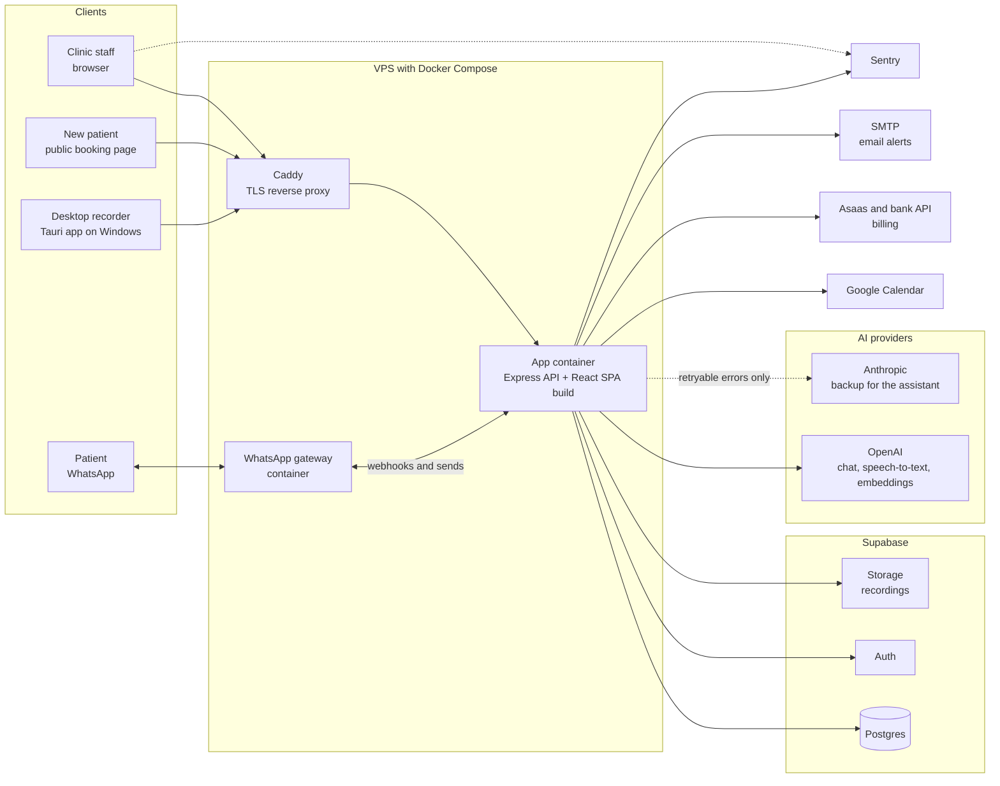
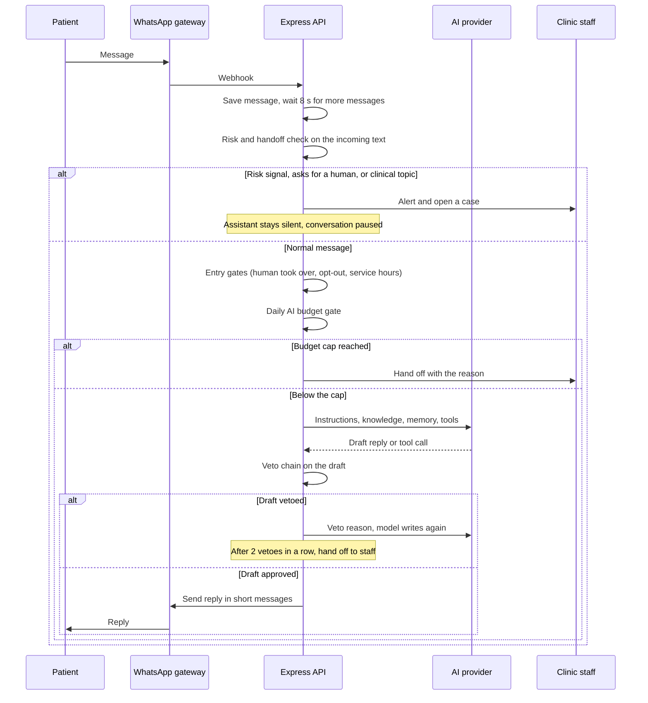
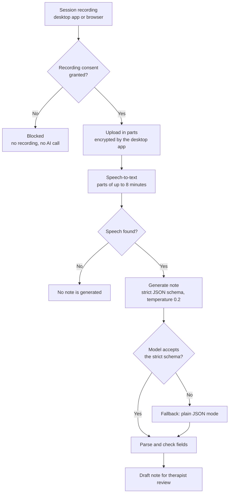

# Agiliza Terapias: Architecture

**TL;DR:** One Express API serves a React single-page app and talks to Supabase, a WhatsApp gateway, AI providers, billing and calendar services. It runs with Docker Compose behind Caddy on one VPS, and GitHub Actions builds and deploys it.
For QA, the key part is the AI path: every message from the WhatsApp assistant passes risk checks, a daily budget check and a fixed veto chain before it is sent.

Related documents: [Overview](overview.md) · [QA strategy](qa-strategy.md) · [Test cases](test-cases.md) · [AI feature testing](ai-feature-testing.md) · [Release validation](release-validation.md)

---

## 1. System context

| Component | Role | Notes for testers |
|---|---|---|
| React SPA | Staff screens and the public booking page | Render tests check screens as HTML (no browser needed) |
| Express API | All business rules, webhooks, AI calls, background workers | Most automated tests run here, with a mocked database and mocked providers |
| Supabase | Postgres data, user sign-in, file storage for recordings | Schema changes only through versioned migration files |
| WhatsApp gateway | Receives patient messages (webhook) and sends replies | Runs as its own container next to the app |
| OpenAI | Chat models (assistant, notes, classifiers), speech-to-text, embeddings for the knowledge base | Never called for real in automated tests; `fetch` is stubbed |
| Anthropic | Backup chat provider for the WhatsApp assistant only | Used only after a retryable failure of the primary provider |
| Google Calendar, Asaas, bank API | Calendar sync and billing | Enabled step by step, each with a manual smoke test |
| SMTP | Email channel for risk alerts and notices | Second channel next to WhatsApp |
| Desktop recorder | Records the session, encrypts it locally, uploads it in parts | Hardware tests (real microphone) are manual |
| Sentry | Error monitoring in browser and server | Server events are cleaned of personal data before sending |

## 2. Build and deploy

```mermaid
flowchart LR
  PR["Pull request<br/>or manual run"] --> Lint["Lint<br/>tsc + ESLint"]
  Lint --> Build["Build<br/>Vite"]
  Build --> Tests["Tests<br/>Vitest + Supertest"]
  Tests --> DbCheck["Migration lint<br/>db:check"]
  DbCheck -->|manual run on main| Image["Build and push<br/>Docker image"]
  Image --> Migrate["Apply pending<br/>migrations"]
  Migrate --> Deploy["Deploy over SSH<br/>docker compose up"]
  Deploy --> Smoke["Smoke check<br/>health and ready endpoints"]
  Smoke --> Monitor["Sentry<br/>monitoring"]
```

- One workflow file with four jobs: `ci`, `docker_image`, `db_migrate`, `deploy_vps`. Each job needs the previous one to pass.
- The `ci` job runs on every pull request. The deploy jobs run only on a manual run on `main`. Details: [Release validation](release-validation.md).

## 3. How an AI request flows through the guardrails

This is the path of one patient message to the WhatsApp assistant.

Step by step:

1. **Receive.** The gateway sends a webhook. The API saves the message in the inbox first. A server restart can lose a pending automatic reply, but not the message.
2. **Group.** The assistant waits 8 seconds of silence, so "hi / I want to book / for Thursday" gets one reply.
3. **Preconditions.** The assistant runs only if the clinic turned it on and set a phone number for risk alerts. It uses a patient's data only when the WhatsApp number matches the patient's record exactly.
4. **Risk and handoff check (before any AI call).** A fixed detector reads the incoming text. A risk signal means: the assistant does not reply, staff get an urgent alert, and the conversation is paused. A request for a human or a clinical topic (medication, reports) also goes to staff. This runs before the model, so it still works when the AI provider is down or the budget is used up.
5. **Entry gates.** If a staff member took over the conversation and the pause has not ended, the assistant does nothing and spends nothing.
6. **Budget gate.** The daily AI spend of the clinic must be below its cap. If not, there is no AI call and staff get the conversation with the reason.
7. **Model call.** The prompt has the clinic's instructions, matching knowledge base passages, the conversation memory and the tools (list free times, book, reschedule, my sessions). When text written by the person goes into the instructions, it is quoted and marked as data, not as an instruction. Output tokens per turn and tool rounds per turn (3) are limited.
8. **Provider fallback.** If OpenAI fails with a retryable error (network, timeout, 5xx, 429, 401/402/403), the same request goes to Anthropic with the same temperature and tools. A 400 error does not go to the backup.
9. **Veto chain.** Six gates check the draft text, in a fixed order: opt-out, human took over, service hours, forbidden promise, promise to call back without a case, self-identification in the first message. A gate never rewrites text. It sends the reason back to the model, and the model writes again. Two vetoes in a row hand the conversation to staff.
10. **Send and log.** The reply goes out in short messages. Each turn is logged on the "AI Executions" screen (replied, handed off, did not reply, failed), and each AI call writes a usage row with real token counts.

Full guardrail details and tests: [AI feature testing](ai-feature-testing.md).

## 4. AI clinical note flow

- The note is always a draft. The therapist reviews and finalizes it.
- The clinical note has no backup provider. If OpenAI fails, the user sees an error and tries again. A retry of the same session is not billed twice.

## 5. Code layout (for developers)

| Path | Content |
|---|---|
| `src/` | React SPA screens and components |
| `src/lib/` | Shared pure logic (guardrail chain, handoff rules, budget, clinic hours). Easy to unit test |
| `src/backend/` | Controllers and services (AI, agent, inbox, billing, automations) |
| `server.ts` | Express app setup, middleware order, Sentry init |
| `tests/backend/` | 479 Vitest test files (unit, API with Supertest, render, migration) |
| `tests/e2e/` | Playwright smoke spec |
| `supabase/migrations/` | 145 versioned SQL migrations |
| `ops/` | Migration runner, preflight checks, rollback script and rollback SQL |
| `apps/` | Desktop recorder (Tauri) |

---

[← Back to portfolio](../../README.md)
