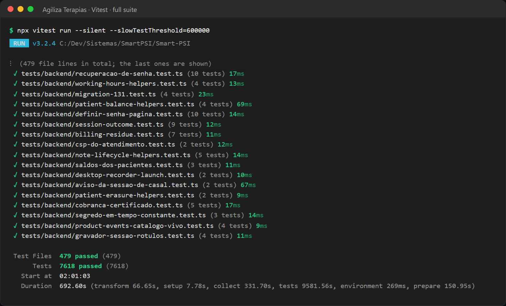
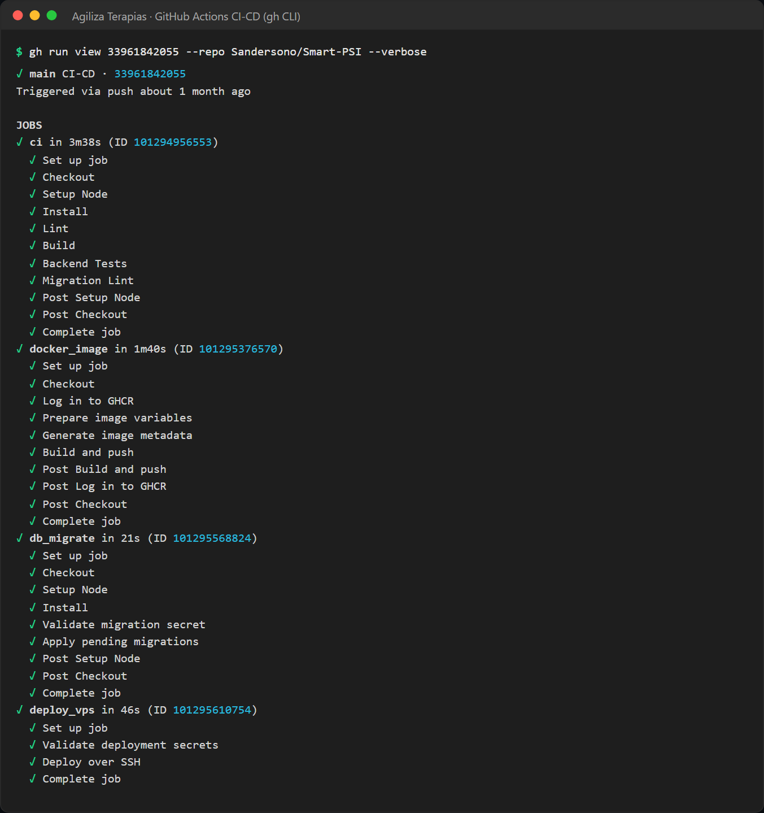

# Agiliza Terapias: QA Strategy

**TL;DR:** This is my test strategy for a mental-health practice app with AI features. I test by risk: patient safety, health-data privacy and AI behavior come first.
The automated suite has 7,594 Vitest test cases in 479 files and runs as a CI gate on every pull request. Live AI conversations, hardware and real phones stay manual, with written check steps in each release note.

Related documents: [Overview](overview.md) · [Architecture](architecture.md) · [Test cases](test-cases.md) · [AI feature testing](ai-feature-testing.md) · [Release validation](release-validation.md)

---

## 1. Scope

**In scope**
- Web app: React screens and the Express API (scheduling, patient records, inbox, automations, billing, permissions).
- AI features: WhatsApp AI assistant, AI clinical notes, AI reply suggestion, AI reading of confirmation replies, knowledge base search.
- Database migrations and the migration runner.
- API used by the desktop recorder.
- Release process: CI gates, deploy smoke check, monitoring.

**Out of scope or limited**
- Internals of third-party services (OpenAI, Anthropic, WhatsApp gateway, Asaas). I test my code at their boundary with stubbed responses.
- Load and performance testing: not done yet.
- Visual and accessibility testing: planned (see section 13).
- Desktop app user interface: manual only.

## 2. Quality goals

1. **Patient safety.** The AI assistant never sends unsafe text. A risk signal always goes to a human.
2. **Privacy of health data.** No personal or clinical data in logs, error reports or alert previews. Each role sees only what it needs.
3. **Correct schedule and money.** No double booking, no double billing.
4. **No data loss.** Migrations are checked before they run and have a rollback plan.
5. **No regressions.** Every change runs the full suite before merge.
6. **Clear Portuguese for non-technical users.** Error messages say what to do, not technical codes.

## 3. Risk-based testing

| # | Risk | Why it matters | Mitigation in the product | How I test it (file, test cases) |
|---|---|---|---|---|
| R1 | Health-data privacy leak | Therapy data is very sensitive | Error reports cleaned before sending; logs without personal data; role-based menus and data; risk alert by WhatsApp has no name and no message text | `sentry-sem-dados-pessoais` (6), `logs-sem-dado-pessoal` (22), `security-hardening` (168), `agente-alerta-de-risco` (34) |
| R2 | Unsafe or wrong AI output | A patient can receive a false promise or a diagnosis | Fixed veto chain on every assistant message; strict JSON schema for clinical notes; knowledge passages only above a similarity threshold | `agente-cadeia-de-veto` (29), `nota-clinica-schema-estrito` (10), `conhecimento-trechos-e-material` (8) |
| R3 | AI acts after a human took over | The assistant writes over a staff member | Pause with an end time; entry gate stops the turn before any AI call | `agente-turno` (44), `agente-despacho` (51), `agente-cadeia-de-veto` (29) |
| R4 | AI cost runaway | A loop or a large context can spend money fast | Daily spend cap checked before every AI call; output token cap per turn; 3 tool rounds per turn; per-user request limit | `agente-orcamento` (32), `chamada-com-reserva` (18), `limite-de-uso-por-usuario` (5) |
| R5 | Scheduling or billing errors | Lost sessions, wrong charges | Database lock against overlapping sessions; 12-hour rule for AI reschedules; "pay before confirm" rule; one bill per AI session even on retry | `agenda-corrida-do-horario` (22), `trava-de-pagamento` (21), `ai-billing-session-dedup` (6) |
| R6 | Migration breaks data | Data loss in production | `db:check` lint, checksum drift check, one transaction per file, rollback SQL, one test per migration | `migration-*` (17 files, 138), `migration-plan` (15), `db-migrate-runner` (11) |
| R7 | Release regression | A fix breaks another flow | Full suite on every pull request; API surface smoke test; deploy smoke check; real-world check steps in the release note | `api-surface-smoke` (28), CI `ci` job, [Release validation](release-validation.md) |

Numbers in parentheses are test cases in that file, from `npx vitest list --json` on 2026-10-16.

## 4. Test levels

| Level | What it covers | How I counted | Files | Test cases |
|---|---|---|---|---|
| Unit and service tests (Vitest) | Pure functions (guardrails, rules, parsers) and services with a mocked database and stubbed AI providers | Test files that are not in the other rows | 255 | 4,062 |
| API tests (Vitest + Supertest) | HTTP routes: status codes, permissions, validation, what is saved | Files that import `supertest` (and not `react-dom/server`) | 136 | 2,176 |
| Render tests (Vitest, `.tsx`) | React screens rendered to HTML: texts, buttons, role-based content | Files that import `react-dom/server` (and not `supertest`) | 68 | 1,125 |
| API + render in one file | Both styles in the same file | Files that import both | 3 | 93 |
| Migration tests (Vitest) | Each recent SQL migration: lint, planned columns and constraints, rollback script | Files named `migration-*` | 17 | 138 |
| **Total Vitest** | | `tests/backend/**/*.test.{ts,tsx}` | **479** | **7,594** |
| Browser smoke (Playwright) | Sign-in screens, self-service checkout with a mocked payment page, secretary menu | `tests/e2e/smoke.spec.ts` | 1 | 4 |
| Manual real-world checks | Live AI behavior on WhatsApp, mobile screens, desktop recorder, third-party flows | "Prova real" (real-world check) sections in release notes | 15 notes | n/a |

Notes:
- I counted on 2026-10-16. Test cases come from `npx vitest list --json`. No test in the suite is marked `skip`, `todo` or `only`.
- The Playwright smoke runs only when a target URL is set. It is not part of the CI job today.



*Full Vitest run on my machine (October 17, 2026): 479 files and 7,618 tests passed. This is 24 more test cases than the October 16 count in the table, because tests were added after that count.*

## 5. Test design techniques

| Technique | Where I use it | Example |
|---|---|---|
| Equivalence partitioning | Valid and invalid input classes | Public booking with and without consent; risk phrases vs. normal messages |
| Boundary value analysis | Limits and time edges | Clinic closes at 18:00: 17:59 is open, 18:00 is closed. Spend equal to the daily cap is blocked |
| Decision table | Rules with many conditions | The 6-gate veto chain; provider fallback by error type; role x action permissions |
| State transition | Things with a lifecycle | Staff pause active vs. expired; note active, in trash, restored; decline of a reminder valid for one turn only |
| Error guessing | Known failure patterns | Two people booking the same slot at the same time; invalid JSON from the model; accent at the end of a Portuguese word breaking a regex |

Many tests are written in pairs: "the guard blocks X" and "the guard does not block normal Y". Without the pair, a guard that always blocks would pass. Details: [Test cases](test-cases.md).

## 6. Test data policy

This is a mental-health product, so test data rules are strict:

- **Synthetic data only** in automated tests: fake names, fake phone numbers, `example.com` emails, invented session text.
- **No real AI calls** in automated tests. `fetch` is stubbed, so tests are fast, free and repeatable.
- **Mocked database** (a shared Supabase mock helper) for unit and API tests.
- **No production data** is copied to a test environment. The restore drill in the runbook uses a synthetic seed with fake clinics and fake users.
- **Manual checks** in production use test phone numbers and test patients, as written in each release note.
- **No secrets** in tests. Test keys are dummy strings.

## 7. CI/CD gates (in order)

| Order | Gate | Command or action | Runs on |
|---|---|---|---|
| 1 | Type check and lint | `npm run lint` (`tsc --noEmit` + ESLint) | Every pull request and manual run |
| 2 | Build | `npm run build` (Vite) | Every pull request and manual run |
| 3 | Automated tests | `npm test` (`vitest run`, all 479 files) | Every pull request and manual run |
| 4 | Migration lint | `npm run db:check` | Every pull request and manual run |
| 5 | Docker image | Build and push the image, tagged with the commit SHA | Manual run on `main` only |
| 6 | Apply migrations | `npm run db:migrate`. The job fails before deploy if the database secret is missing | Manual run on `main` only |
| 7 | Deploy | Pull and start the new image with Docker Compose over SSH | Manual run on `main` only |
| 8 | Deploy smoke | Health and readiness endpoints must answer, up to 30 tries, 5 seconds apart | Manual run on `main` only |

Each job needs the previous job to pass. Since 2026-09-07, a push to `main` does not deploy by itself. Deploy is an explicit action, because a deploy that nobody is watching is worse than a slow deploy.



*A green CI-CD run on `main` (September 5, 2026), shown with the GitHub CLI. It is from before deploy became a manual action: the `ci` job (lint, build, backend tests, migration lint) passed first, and then the image, migration and deploy jobs ran.*

## 8. What stays manual, and why

| Area | Why it is manual | How I check it |
|---|---|---|
| Live AI conversations on WhatsApp | Model output changes from run to run, real calls cost money, and it needs a real WhatsApp number | Real-world check steps in the release note, with two test phone numbers |
| Quality of clinical note content | Needs clinical judgment | A therapist reviews AI notes; the note is always a draft |
| Desktop recorder | Needs a real microphone and Windows | Manual recording, upload and recovery checks |
| Mobile screens | Real keyboards on iPhone and Android | Checklist in the release note (for example, v0.4.0) |
| Third-party flows | Payment sandbox, Google sign-in, WhatsApp pairing | Manual smoke test before an integration is turned on |
| Production migrations | Risk to real data | Applied only after my explicit go decision |
| Browser smoke | Needs a running environment and a test account | Playwright run against the target URL |

## 9. Entry and exit criteria

**Entry criteria (start testing a release candidate)**
- The request or spec is written (spec folder, backlog item or release note draft).
- The pre-release note exists (`npm run release:notes`).
- A new migration comes with a dedicated test and a rollback script (my practice since migration 129).
- Lint and build pass on my machine.

**Exit criteria (go / no-go)**
- CI `ci` job is green: lint, build, all Vitest tests, migration lint.
- No open S1 or S2 defect in the release scope.
- The release note is complete: what changed, known limits (if any), and real-world check steps when users can see the change.
- The real-world check is done for AI and WhatsApp changes.
- After deploy: health and readiness endpoints are OK, and the version and commit from the version endpoint match the release.
- Sentry shows no new error spike after the release.

**Rollback triggers** (from my go-live runbook): readiness fails after warm-up, real sign-in is broken, sustained 5xx errors in a main flow, a financial mismatch caused by the deploy, risk of data showing in the wrong clinic, or a migration that does not fit the new version. I roll back the app first. I restore the database only for a data incident.

## 10. Defect severity and priority

| Severity | Definition | Example from this product (my classification) |
|---|---|---|
| S1 Critical | Patient safety risk, health-data exposure, data loss, or the AI sends unsafe content | A risk alert is not delivered to the clinic |
| S2 High | A main flow is broken and there is no workaround | v0.3.3 fix: received WhatsApp audios showed 0 seconds and the assistant did not transcribe them |
| S3 Medium | A flow works with a workaround, or the result is wrong in an edge case | v0.3.1 fix: in one flow, the assistant stopped before offering a time and passed the conversation to staff |
| S4 Low | Cosmetic issue, typo, layout | Broken accents in Portuguese text (found in the May 2026 review) |

| Priority | Meaning |
|---|---|
| P1 | Fix now, as a patch release |
| P2 | Fix in the next planned release |
| P3 | Backlog |

**Defect report format.** My release notes follow the same structure as a defect report, so each fix can be reproduced:

| Field | Content |
|---|---|
| Title and version | Short summary, release number |
| Problem | What the user saw (actual result) and what should happen (expected result) |
| Steps to reproduce | Preconditions and numbered steps |
| Severity / priority | S1-S4, P1-P3 |
| Fix | What changed, in plain words |
| Tests added | Test names that now cover the case (regression) |
| Known limits | What the fix does not cover |
| Real-world check | Manual steps to confirm the fix after deploy |

A full example is in [Release validation](release-validation.md).

## 11. Production monitoring with Sentry

- Sentry runs in the browser (`@sentry/react`) and on the server (`@sentry/node`), with a default trace sample rate of 10%.
- Before a server event leaves, a cleaning step removes request bodies, cookies, query strings, headers that are not on an allow list, and database error text that can contain a row of data. A test file checks this (`sentry-sem-dados-pessoais`, 6 test cases).
- Critical failures are logged as errors, so Sentry shows them. Examples: a risk alert that failed on both channels, and both AI providers failing.
- When the primary AI provider fails, an operations alert goes out at most once per hour, without the provider's raw error text (tested in `chamada-com-reserva`).
- Health and readiness endpoints show process, build and minimum database schema. The "AI Executions" screen shows the outcome of every assistant turn.

## 12. Multidisciplinary review (May 2026)

I ran a structured review of the product in two rounds (2026-05-01 and 2026-05-04), with 10 senior lenses each: product, UX, frontend, backend, security and privacy, DevOps/SRE, database, clinical AI, integrations, and QA/E2E. Each round produced P0/P1/P2 priorities.

**QA and E2E findings (summary)**
- P0: add end-to-end tests for the go-live journeys (sign-in, subscription, patient, schedule, clinical note, AI billing, support) as a gate before deploy.
- P0: deploy with a readiness check, a smoke test after deploy and a written rollback, plus a database restore test.
- P0: validate the AI clinical note output against a schema and handle invalid AI responses.
- QA package for the pilot: end-to-end tests for sandbox subscription to sign-in, recurring schedule views, templates, manual payments, WhatsApp status and onboarding.
- P2: visual, accessibility and mobile tests, and a staging environment with synthetic data.

**What I did**
- Readiness endpoint and a deploy smoke check in the CI deploy job.
- A rollback script, and rollback SQL for each recent migration (15 files, migrations 128 to 142).
- Strict JSON schema for clinical notes and a consent check before any audio processing (both covered by tests). Invalid AI JSON now returns a controlled error message (a direct test for this path is still on my list).
- A migration pipeline with lint, checksum drift detection and one test per new migration.
- API-level coverage grew to 139 Supertest files, including an API surface smoke test (28 test cases).
- A Playwright smoke spec for sign-in screens, self-service checkout and the secretary menu (4 tests).

**Still open**
- Full browser journeys in CI (the Playwright smoke is small and manual today).
- An automated restore drill (the drill is written in the runbook but not automated).
- Visual and accessibility tests, and a permanent staging environment.

## 13. Tools

| Tool | Use |
|---|---|
| Vitest 3 | Unit, service, render and migration tests |
| Supertest 7 | API tests against the Express app |
| Playwright 1.52 | Browser smoke tests (Chromium) |
| TypeScript compiler, ESLint 9 | Static checks in the lint gate |
| GitHub Actions | CI gates, image build, migration and deploy jobs |
| Docker Compose, Caddy | Runtime on the VPS |
| Sentry | Production error monitoring |
| Custom migration runner (`db:check`, `db:migrate`) | Migration lint, drift check, apply with lock |
| Release notes script (`release:notes`) | Pre-release note template for every version |

## 14. Test excerpt

From `tests/backend/agente-turno.test.ts` (test names are in Portuguese):

```ts
describe("portões que não dependem do texto barram antes de gastar", () => {
  it("humano assumiu: o agente não escreve por cima nem paga chamada", async () => {
    const { entrada, executar } = turno({
      contexto: { ...CONTEXTO_NORMAL, humanoAssumiuAte: new Date(Date.now() + 3600_000) },
    });

    const r = await executar();

    expect(r.acao).toBe("nao_fazer_nada");
    expect(entrada.chamarModelo).not.toHaveBeenCalled();
  });

  it("prazo vencido devolve a conversa ao agente sozinho", async () => {
    const r = await turno({
      contexto: { ...CONTEXTO_NORMAL, humanoAssumiuAte: new Date(Date.now() - 3600_000) },
    }).executar();
    expect(r.acao).toBe("responder");
  });
  // ...
```

**In English:** while a staff member's takeover is still active, the assistant does nothing and never calls the AI model; once the takeover time has passed, the assistant answers again.

---

[← Back to portfolio](../../README.md)
