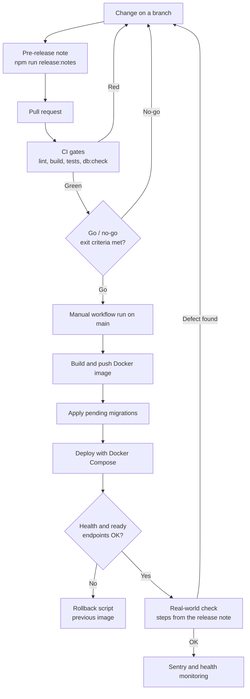

# Agiliza Terapias: Release Validation

**TL;DR:** Every release goes through CI gates, a migration check, a written pre-release note, a manual go decision, a deploy smoke check and Sentry monitoring.
I wrote 301 pre-release notes (v0.1.1 to v0.4.0). Each note says what changed; newer notes also list known limits and the manual steps to check the change after deploy.

Related documents: [Overview](overview.md) · [Architecture](architecture.md) · [QA strategy](qa-strategy.md) · [Test cases](test-cases.md) · [AI feature testing](ai-feature-testing.md)

---

## 1. Release flow

| Step | What happens | Evidence in the repo |
|---|---|---|
| Version | Semantic versioning in `package.json`. Since the 0.2 series: MINOR for a new feature or a new action for clinics, PATCH for a fix | `package.json` is at 0.4.0 |
| Pre-release note | `npm run release:notes -- --version X.Y.Z --type pre-release` creates the file; I fill it in | 301 files in `docs/releases/` |
| CI gates | Lint (`tsc` + ESLint), build, all 479 Vitest files, migration lint | Job `ci` in the workflow |
| Go / no-go | Exit criteria from the [QA strategy](qa-strategy.md#9-entry-and-exit-criteria) | Manual decision |
| Deploy | Manual workflow run on `main`: image, migrations, deploy over SSH | Jobs `docker_image`, `db_migrate`, `deploy_vps` |
| Smoke | Health and readiness endpoints, up to 30 tries, 5 seconds apart. A failure fails the job | Last step of `deploy_vps` |
| Real-world check | Manual steps written in the note ("Prova real") | 15 notes have this section |
| Monitoring | Sentry, health panel, "AI Executions" screen | See [QA strategy](qa-strategy.md#11-production-monitoring-with-sentry) |

The build writes version, build time, commit and branch into the app. The version endpoint, the health endpoint and the app footer show them, so I can confirm that production runs the commit I validated.

## 2. Pre-release notes (`release:notes`)

**What the script does**
- Creates `docs/releases/pre-release-vX.Y.Z.md` from a template, with the version from `package.json` by default.
- Refuses to overwrite an existing note unless I pass `--force`. `--dry-run` only prints the template.
- Template sections (translated): plain-language summary, improvements, fixes, new features, changes in how to use the system, in validation, notes for support, suggested message to clients.

**Writing rules** (from the release notes guide, translated)
- Write for non-technical users. Use the name of the screen, not the name of the code.
- Separate what is ready from what is still in validation.
- If users must do something, say exactly what. If not, say "No action needed".

Over time I added three sections that a tester needs: **known limits**, **real-world check** steps, and a short **technical details** part that lists the tests added. The internal admin console shows the notes on a "Versions" tab. A test checks that this view returns a client-safe payload without the operational sections (`release-notes-service.test.ts`, 3 test cases).

**Count of notes** (files `docs/releases/pre-release-*.md`, counted 2026-10-16)

| Series | Notes |
|---|---|
| 0.1.x | 295 |
| 0.2.x | 1 |
| 0.3.x | 4 |
| 0.4.x | 1 |
| **Total** | **301** |

- Dates in the notes: 2026-05-01 to 2026-10-15.
- 15 notes have a "Prova real" (real-world check) section. 11 notes have a "Limites conhecidos" (known limits) section.
- No final `release-*.md` files exist yet. All notes are pre-releases.

## 3. Database migration safety

| Control | What it does |
|---|---|
| Versioned files | 145 SQL files in `supabase/migrations/`. New files follow the name pattern `YYYYMMDD_NNN_description.sql` |
| `npm run db:check` (CI) | Without a database: lints file names (pattern, duplicate numbers) and content (no top-level transaction commands in new files, because the runner adds its own). With a database: compares files with the applied list |
| Drift check | An already applied migration that was edited later has a different checksum. The runner stops with an error |
| `npm run db:migrate` | One transaction per file, stop at the first failure, a lock so only one runner works at a time. It records each file's checksum and run time |
| CI order | Migrations run before the new app version starts. The job fails before deploy if the database connection is not configured, to avoid a schema mismatch |
| Migration tests | 17 files named `migration-*` (138 test cases). A recent migration test checks: it passes the lint, the planned columns, constraints and indexes exist, a rollback script exists and runs in one transaction, and the app's readiness check requires the new tables |
| Runner tests | `migration-plan.test.ts` (15) and `db-migrate-runner.test.ts` (11): sort order, name lint, pending and drift detection, stable checksum across Windows and Linux line endings |
| Rollback SQL | 15 rollback files in `ops/rollback/` (migrations 128 to 142) |
| Go decision | A release with migrations is applied only after my explicit OK, and the note says which migrations it brings |

**Runbook, high level** (translated and summarized)
- A restore drill uses only synthetic data: build the migration bundle, apply it to a throwaway database, insert a synthetic seed (fake clinics and users), dump, restore to another clean database, compare table counts and samples, record the evidence. Real data and dump files are never used or saved in the repo.
- If a migration could need a database restore to roll back, I mark it in the deploy plan before the release window.
- Rollback order: roll back the app first. Restore the database only for a data incident, a destructive migration or a wrong backfill. Before a restore: stop writes, keep the logs, save a copy of the current state.

## 4. Release checklist

Derived from my versioning guide, go-live runbook and release notes, translated and sanitized.

**Before the release**
- [ ] Version updated in `package.json` (MINOR = new feature, PATCH = fix).
- [ ] Pre-release note written in plain language: what changed, ready vs. in validation, user action or "No action needed".
- [ ] Known limits listed.
- [ ] Real-world check steps written for every user-visible change.
- [ ] Each new migration has a test and a rollback script, and the note lists it.
- [ ] `npm run lint`, `npm test`, `npm run build` and `npm run db:check` are green (CI job `ci`).
- [ ] Backlog updated when a delivery closes or a priority changes.
- [ ] Deploy record ready: current version, current commit, current image tag, next image tag, migrations to apply, time window.

**Deploy**
- [ ] Manual workflow run on `main` (go decision).
- [ ] Migrations applied with no error.
- [ ] The new image tag is recorded, and the previous deploy state is kept for rollback.

**After the release**
- [ ] Version, health and readiness endpoints answer, and the version and commit match the release.
- [ ] Real-world check steps done (AI and WhatsApp changes with test phone numbers).
- [ ] Sentry shows no new errors; the health panel is green.
- [ ] If a rollback trigger happens: run the rollback script, check the endpoints again, record the incident (version, image tag, commit, time, readiness result).

## 5. Sample pre-release note (v0.3.2, rewritten in English)

I picked v0.3.2 because it is recent (same day as v0.4.0) and it is an AI behavior fix. It has the full defect story: problem, fix, tests, limits and a manual check. Internal function names are summarized.

> **Agiliza Terapias 0.3.2**
> Type: pre-release · Version: 0.3.2 · Date: 2026-10-15 · Audience: all clinics
>
> Patch (bug fix), requested by the product owner: when a time offered by the assistant is taken before the person confirms, the assistant says that someone else booked it and offers other free times. No migration.
>
> **Summary in plain language**
> - Before booking, the system always checks that the time is still free. This already happened when saving: the database refuses two bookings for the same time in the same second.
> - What changed is what the assistant says when the time was taken: "someone else already booked this time", and in the same reply, other free times to choose from. If the time became a blocked time in the schedule, it says the time is no longer available, without mentioning another person.
> - The assistant books the new time only after the person chooses again. In the same turn where the chosen time was taken, the other option of the offer is refused, because the person did not choose it.
> - When rescheduling from a reminder reply, a booked or unavailable time also leads to other options, and no longer to the staff.
>
> **Technical details (summary)**
> - The scheduling engine marks a "time taken" error with a reason: "booked" (another person's session, or a lost race) or "unavailable" (a blocked time). The public booking page keeps the same message and HTTP 409.
> - The assistant's booking tools turn the marked error into a clear instruction for the model: tell the person, list free times now, offer others. After a taken time, another booking in the same turn is refused.
> - Assistant instructions: a time that is already booked is not a reason to call staff. Offer other times.
>
> **Tests added**
> - Booking a time that someone else booked, a blocked time, and the patient's own session at the same time.
> - The other option of the offer refused in the same turn.
> - Rescheduling to a booked time.
> - The booking and rescheduling races marked as "booked".
>
> **Known limits**
> - A new contact who loses the time keeps the new patient record (as before: the record is created before the check).
> - Two turns from the same person at the same moment for the same time: the second one hears "someone else already booked" (rare).
>
> **Real-world check**
> - With two test phone numbers: the assistant offers a time to the first number. Book that same time from the staff schedule. The first number replies "pode ser" (that works) and hears that someone else already booked, with other options. Repeat with a two-option offer and with a reschedule.

How this note maps to a defect report: the first paragraph is the problem and the expected result, "Tests added" is the regression coverage, and "Real-world check" is the reproducible verification after deploy. The same case is test case AGT-TC-25 in [Test cases](test-cases.md).

---

[← Back to portfolio](../../README.md)
