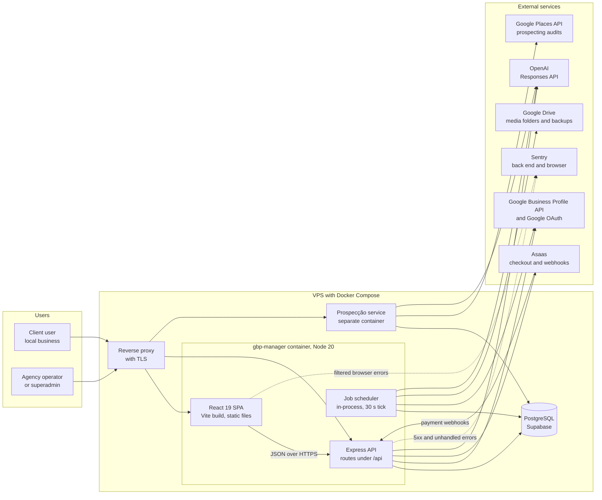
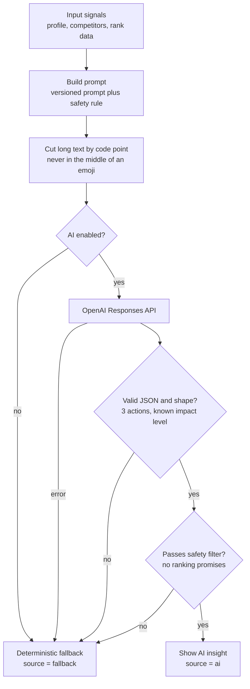
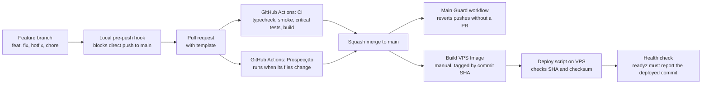

# GBP Manager: Architecture

**TL;DR:** A React single-page app and an Express API run in one Docker container on a VPS, with PostgreSQL (Supabase) and an in-process job scheduler.
The API talks to Google, Asaas and OpenAI. Sentry receives real errors from the back end and the browser.
Client data isolation is the highest testing priority, so it has a critical automated suite that runs on every pull request.

Related documents: [Overview](overview.md) · [QA strategy](qa-strategy.md) · [Test cases](test-cases.md) · [Release validation](release-validation.md)

---

## System context

## Main parts

| Part | What it does | Main test focus |
|---|---|---|
| React SPA | Client, agency and superadmin screens. Bilingual (Portuguese and English). Responsive for mobile. | Playwright journeys on Desktop Chrome and Pixel 7, contrast and layout contract tests |
| Express API | REST endpoints, roles and permissions, billing rules, Google and AI calls. Also serves the built SPA. | API end-to-end scenarios, permission tests, error handling tests |
| Job scheduler | Runs background jobs inside the API process. | Dry-run planners, failure recording, alert tests |
| PostgreSQL (Supabase) | Main data store. Schema changes go through node-pg-migrate. | Migration runner tests, temporary schema for API end-to-end tests |
| Prospecção service | Separate app and container for prospecting audits and A4 reports. | Its own unit tests, Playwright visual and print tests, its own CI workflow |
| Sentry | Error monitoring for back end and browser. | Tests for the filter that decides what is reported |

## Background jobs

The scheduler checks every 30 seconds which jobs are due. Examples of jobs:

- sync Google reviews, and reply to reviews with AI;
- publish scheduled posts and Auto-Gallery photos;
- sync Google performance data;
- monthly local rank scan;
- holiday calendar sync and holiday gap notices;
- client health check and data retention cleanup;
- billing reminders and monthly billing recurrence;
- database backup;
- retry of support ticket delivery.

Each run is saved in a run history. Failures go to a dead-letter list. The superadmin overview names each job that keeps failing, with the days since its last success.

## AI request path

All AI features follow the same safety idea: the AI output is checked, and a deterministic fallback replaces it when something is wrong. This diagram shows the local rank insight.

Other AI controls in the product:

- Prompts are stored as versions in the database, so I can roll back a prompt.
- Each automatic post saves a short fingerprint (12 hex characters) of the prompt template that produced it.
- The prospecting report has its own safety filter: no false promises, no secrets, and no price or checkout words in the client report.

## Multi-tenant isolation (high level)

GBP Manager serves many businesses from one database. The rules, at a high level:

- A user sees only the business locations that were granted to that user.
- Roles separate client users, agency admins and superadmins. Finance screens need an extra permission on top of the superadmin role.
- Background jobs must also respect client scope. A job that publishes to the wrong profile is a No-Go condition in my release checklist.

### Why isolation drives testing priorities

- A defect here shows one business's data to another business. That is the most severe defect class in this product.
- So isolation is covered by a **critical automated suite** that runs in CI on every pull request (`test:critical`).
- The API end-to-end tests try cross-client access and expect a refusal.
- The release gate (`release:check`) fails if the isolation test files or their key scenarios disappear.
- Changes to data, tenant or permission rules have their own Go/No-Go section. It asks for tests of allowed access and of cross-client and cross-role attempts, and for a backup before any bulk change.

I do not describe the isolation implementation here. This repository is public and the source is private.

## CI/CD and deploy

Deploy safety rules from the deploy runbook:

- The script checks the expected commit SHA before it starts the container.
- Mutable image tags such as `latest` are blocked by default. An image file must come with a SHA-256 checksum.
- The new container is accepted only if `/api/readyz` reports the same commit that was deployed.
- Deploying a `Revert` commit is blocked by default and needs explicit approval.

## Health and observability endpoints

| Endpoint or tool | What it tells me |
|---|---|
| `/api/livez` | The API process is alive. |
| `/api/readyz` | Running commit, database connection, and whether Sentry is on (true or false only). |
| Sentry | 5xx errors and unhandled exceptions, tagged with the running commit. 4xx responses are filtered out. |
| Operations screen and superadmin overview | Job run history, dead letters, and jobs that keep failing. |

More detail on monitoring is in [QA strategy](qa-strategy.md#11-production-monitoring-with-sentry).

---

[← Back to portfolio](../../README.md)
