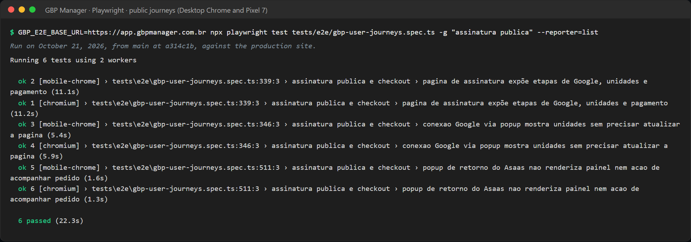
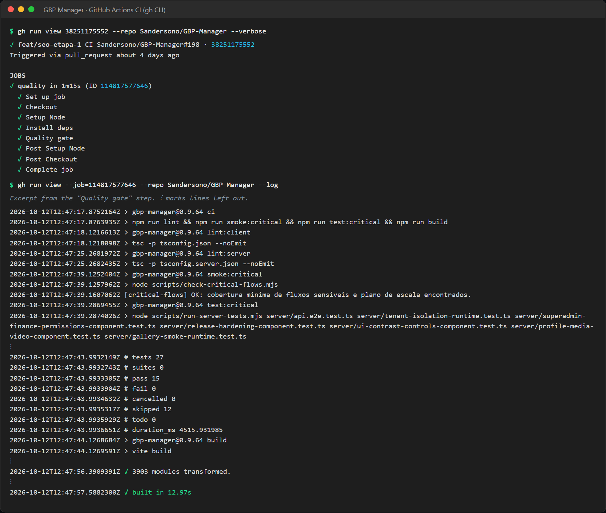

# GBP Manager: QA Strategy

**TL;DR:** I test by risk. Client data isolation, billing, Google integration, AI output, release regressions and text quality get the most attention.
Every pull request passes four CI gates: typecheck, critical-flow guard, critical test suite, build. Real Google OAuth and the Asaas sandbox stay manual and are signed off with evidence.
In production, Sentry reports only real defects (5xx and unhandled errors), not expected 4xx responses.

Related documents: [Overview](overview.md) · [Architecture](architecture.md) · [Test cases](test-cases.md) · [Bug case study](bug-case-study.md) · [Release validation](release-validation.md)

---

## 1. Scope

**In scope**

- Web app for client users, agency admins and superadmins (desktop and mobile browsers).
- Express API, background jobs and database migrations.
- Integrations: Google Business Profile API and OAuth, Google Drive, Asaas billing, OpenAI.
- Prospecção module (prospecting audit and A4 report).
- Release process: notes, evidence, go/no-go, deploy checks, monitoring.

**Out of scope**

- Google's and Asaas's own systems. I test my integration with them, not the providers.
- Load testing. I have a capacity probe script, performance guard tests and a scale plan with budgets, but no load test suite.

## 2. Quality goals

1. No business can see or change another business's data.
2. No access without confirmed payment, and no duplicate charge.
3. Google and Asaas failures show a clear message and never break the whole job cycle.
4. AI output never promises results it cannot deliver and never mixes clients. When AI fails, the user still gets a safe answer.
5. Every release has a written go/no-go decision, a rollback criterion and evidence.
6. Text the customer reads is correct Portuguese (or English) and is never cut in silence.

## 3. Risk-based testing

| # | Risk | Impact | How I reduce it |
|---|---|---|---|
| R1 | **Tenant data isolation:** one business sees another's data | Critical | Isolation suite in `test:critical`, run in CI on every PR. API end-to-end scenarios try cross-client access and expect HTTP 403. `release:check` fails if the isolation tests disappear. Own Go/No-Go section for data and permission changes. |
| R2 | **Billing and permissions:** access without payment, double charge, finance data shown to the wrong role | Critical | Finance permission test in `test:critical`. Playwright tests for billing-restricted redirects. Asaas tests (HTTP hardening, failure logging, recurrence reconciliation, coupons). Manual Asaas sandbox sign-off. Billing Go/No-Go gate. |
| R3 | **Google API integration failures:** errors, missing data, provider down | High | API end-to-end: explicit "Google unavailable" answer when OAuth is not configured, and dry-run of the Google sync job. Dead-letter and 404 handling tests. Playwright test for the Google popup at signup. Manual sign-off with a real Google account. |
| R4 | **AI output safety:** false ranking promises, broken AI requests, invalid output | High | Safety filter plus schema check plus deterministic fallback, all with unit tests. Report safety filter in the prospecting module. Code-point text cutting. Versioned prompts with rollback. Prompt fingerprint on each automatic post. AI Go/No-Go gate. |
| R5 | **Release regressions** | High | Four CI gates on every PR. Full server suite in `release:check`. Playwright journeys before releases that touch signup, billing, Google, support or main navigation. Bundle size budget. Evidence record with go/no-go and rollback for each release. |
| R6 | **Text quality:** Portuguese errors, duplicated text, text cut in silence | Medium (public, but no data loss) | Accent guard tests over three output channels. `audit:i18n` for translation coverage. One shared character limit with boundary tests. Read-only SQL scans reviewed on a schedule. See [Bug case study](bug-case-study.md). |

## 4. Test levels (test pyramid)

Counts are files in the main branch, counted with `git ls-files` (no `node_modules`, no worktrees). Total: **251 test files** (`*.test.ts`, `*.test.tsx`, `*.spec.ts`).

| Level | What it checks | Count | Runner | Where it runs |
|---|---|---|---|---|
| Unit | Pure functions: business rules, AI safety, text rules, billing math, date logic | 107 server files + 32 prospecting files | node:test + assert (tsx) | Full server suite in `release:check`. Prospecting tests run in its CI workflow. |
| Component / contract | Reads the source and checks that key behavior is wired (for example, a route uses the shared limit, a page has a mobile summary, finance UI is hidden from operational superadmins) | 94 server files (`*-component.test.ts`) | node:test | Full suite; 4 of them are in `test:critical` (CI) |
| Runtime / integration | Modules working together (for example, isolation rules, the gallery dry-run planner, billing runtime) | 14 server files (`*-runtime.test.ts`) | node:test | Full suite; 2 of them are in `test:critical` (CI) |
| API end-to-end | Starts the API on a temporary database schema and calls real HTTP endpoints | 1 file (`api.e2e.test.ts`), 12 scenarios | node:test | `test:critical`. Needs a test database, so it is skipped in CI and runs on my machine. |
| UI journeys | Real browser navigation: client, billing-restricted client, superadmin, signup and checkout | 1 spec, 20 tests, each run on 2 projects (Desktop Chrome and **Pixel 7**) = 40 runs, 1 of them skipped on desktop by design | Playwright | Local, before releases that touch signup, billing, Google, support or main navigation |
| Visual / print | Prospecting A4 report: print-safe width, key content visible, no sales language | 2 specs, 4 tests | Playwright (Chromium) | CI (Prospecção workflow) |
| Smoke scripts | `smoke:critical` (critical-flow guard), `dev:status` (frontend, livez, readyz), `smoke:gallery:ops` (Auto-Gallery dry-run on a real environment), prospecting public URL smoke | scripts | Node | CI, release, post-deploy |

Playwright settings: 45 s per test, 10 s per assertion, and trace, screenshot and video kept on failure, plus an HTML report. Locators accept both languages (for example "Painel Completo" or "Full Dashboard"), so the same test works in Portuguese and English.



*Playwright run of the 3 public signup and checkout journeys against the production site (October 21, 2026), on Desktop Chrome and the Pixel 7 profile: 6 passed. The journeys that need a signed-in user are not in this run.*

## 5. The critical suite (`test:critical`)

Seven test files, chosen by risk. They run in CI on every PR and again in `release:check`.

| Test file | What it protects |
|---|---|
| `api.e2e.test.ts` | Main API flows end to end: roles and cross-client refusal, Google unavailable answer, job dry-run, feature flags by scope, media fallback when AI tagging is off |
| `tenant-isolation-runtime.test.ts` | Client data isolation |
| `superadmin-finance-permissions-component.test.ts` | Finance screens and endpoints need the finance permission |
| `release-hardening-component.test.ts` | The release gate itself, and production runtime guards |
| `ui-contrast-controls-component.test.ts` | Low-contrast UI defects stay fixed |
| `profile-media-video-component.test.ts` | Video publishing is validated and behind a rollout flag |
| `gallery-smoke-runtime.test.ts` | Auto-Gallery planner explains publish, skip and failure decisions without publishing |

### The critical-flow guard (`smoke:critical`)

This script does not test the product. It tests the test setup. It fails the build if:

- a critical test file is missing;
- a key scenario disappears from a test (for example, the cross-client 403 check or the Auto-Gallery skip reasons);
- the go/no-go checklist stops asking for the smoke and critical tests;
- the release scripts stop running the critical tests.

So nobody (including me) can delete a critical check by accident.

## 6. CI gates and branch protection

### Gates on every pull request (GitHub Actions, Node 20)

The CI job runs `npm ci` and then `npm run ci`. The steps are chained, so the first failure stops the run:

1. `lint:client` and `lint:server`: TypeScript type check (no emit) for client and server.
2. `smoke:critical`: the critical-flow guard.
3. `test:critical`: the 7 critical test files.
4. `build`: production build of the front end.

A second workflow runs for the Prospecção module when its files change: Dockerfile checks, unit tests, Playwright tests in Chromium, build and a production runtime smoke.



*A green CI run on a pull request (October 12, 2026), shown with the GitHub CLI. The 12 skipped tests are the API end-to-end scenarios: they need a database, so they run on my machine.*

### Branch protection

Native required checks are not available for this private repository on its current plan. So I enforce the rules in the repo:

- **Local pre-push hook:** blocks a direct push to `main`.
- **Main Guard workflow:** on every push to `main`, it checks that each commit came from a pull request. If not, it reverts the commit. It retries a few times, because GitHub links a PR to its commit with a small delay.
- An emergency bypass exists. It must be written in the commit message, so it stays visible in history. It was last used in July 2026.
- Merge to `main` only by squash merge. Since July 2026, 187 of 200 commits on main came from pull requests.

### Why the type check is a real gate

In September 2026, one PR changed a dashboard query. Its contract tests passed, but the type check was not run before merge. It reported 21 type errors. The dashboard alert read each query result under the wrong name, so it never showed the failing job. I found it about a week later, when a type check failed on the same change. Now the PR template asks for a green `npm run lint` before merge, and I treat the type check as a test, not as style.

## 7. What stays manual, and why

The QA playbook splits tests into "automated local" and "real-world sign-off".

| Flow | Why it is manual | How I record it |
|---|---|---|
| Google OAuth with a real account and real Business Profiles | Real consent screen and real profiles. It cannot run safely in an automated way. | Homologation script; result and pending items in the release evidence |
| Asaas sandbox checkout until the automatic return | Depends on the provider's hosted checkout | Same |
| Asaas sandbox webhook that releases access | Needs the provider to call my API | Same |
| Pix Automático in the sandbox (when enabled for the account) | Provider feature, account-dependent | Same |
| Google jobs that publish or sync real data | They change a public profile | Dry-run first (`smoke:gallery:ops` with `dryRun=1`), then a real check |
| Mobile layout checks | Visual details: no horizontal scroll, buttons do not cover messages | Homologation scripts for mobile (for example v0.9.20 and v0.9.21) |

Rule from the playbook: if the local test passes but the flow depends on Google or Asaas, I finish the sandbox sign-off and attach notes to the release evidence. If I cannot run it before deploy, I record why, and the flow stays "released locally" until the sign-off is done.

## 8. Environments

| Environment | Purpose | What runs there |
|---|---|---|
| Local | Development and homologation | Full server suite, API end-to-end on a temporary schema, Playwright journeys, homologation scripts |
| CI (GitHub Actions, Ubuntu, Node 20) | Gate for every PR and push to main | Typecheck, `smoke:critical`, `test:critical` (API end-to-end skipped: no database), build; Prospecção workflow with Playwright |
| Sandbox / published domain | Real-provider sign-off | Controlled Google account and Asaas sandbox customer. The Playwright suite can also point to a deployed URL. |
| Production (VPS, Docker) | Live product | Post-deploy checks (container health, `/api/readyz` commit), Sentry, Auto-Gallery dry-run smoke |

## 9. Entry and exit criteria

**Entry criteria (start homologation of a change)**

- The change is on a branch with an open PR, and CI is green.
- A homologation script exists for the version: objective, scenarios, acceptance criteria, rollback.
- The public release note and the pre-release manifest exist.
- Test data is ready: test users, sandbox accounts.

**Exit criteria (Go)**

- All homologation scenarios pass, or each open item is written down as an accepted pending item.
- `release:check` passes on the final commit.
- Playwright journeys pass when the change touches signup, billing, Google, support or main navigation.
- No No-Go condition from the [go/no-go checklist](release-validation.md#go-no-go-checklist) is present.
- A rollback criterion is written in the evidence record.
- After deploy: the container is healthy and `/api/readyz` reports the deployed commit.

## 10. Defect severity and priority

I use this scale for defect reports. The backlog uses priorities P0 to P2.

| Severity | Definition | Examples from this product |
|---|---|---|
| S1 Critical | Data leak between clients, money or data loss, wrong charge, app down, publishing to the wrong profile. Blocks the release. | Access released without confirmed payment; a job publishes to another client's profile |
| S2 Major | A main feature fails or gives wrong output, with no easy workaround. Wrong content on a public Google profile. | AI suggestion request fails; service names published without accents |
| S3 Minor | Feature works with a workaround, or a visual issue that hurts clarity | Low contrast on a control in dark mode |
| S4 Trivial | Cosmetic, no impact on use | Small spacing issue |

| Priority | Meaning |
|---|---|
| P0 | Fix now. Blocks the release or needs a hotfix. |
| P1 | Fix in the next release. |
| P2 | Planned improvement in the backlog. |

## 11. Production monitoring with Sentry

Sentry runs on the back end (since August 2026) and in the browser (since v0.9.80, August 2026).

**What is captured**

- 5xx responses and unhandled exceptions.
- Errors with an unknown shape (more noise is better than blindness).
- Each event is tagged with the running commit, the same value that `/api/readyz` reports. So I can match an error to a deploy.

**What is filtered out**

- All 4xx responses (400, 401, 403, 404, 409, 413, 422, 429). They are the system working: validation, permission, billing block.
- A list of expected application error codes, for example a billing block or a payload that is too large.
- In the browser: known noise (ResizeObserver loop, network fetch failures, aborted requests, chunk load failures) and errors from browser extensions or third-party scripts.

**Privacy and cost**

- No default personal data. Authorization headers and cookies are removed. Query strings are removed from URLs. Users are identified only by an internal ID.
- No performance tracing and no session replay, to protect the shared event quota.
- The filter is a pure function with its own tests. One test makes sure 5xx is still reported, so the filter cannot hide real defects.

**Other signals:** `/api/readyz` shows if Sentry is on (true or false, never the key). The superadmin overview names each failing job and the days since its last success. A webhook alert fires when the billing provider fails for infrastructure reasons.

Sentry already found a real AI defect that no test caught. See [Bug case study, case 2](bug-case-study.md#case-2-ai-request-fails-when-a-review-is-cut-in-the-middle-of-an-emoji).

## 12. Tools

| Purpose | Tool |
|---|---|
| Unit, component, runtime and API end-to-end tests | node:test + node:assert, run with tsx |
| UI journeys, visual and print tests | Playwright (Desktop Chrome, Pixel 7, Chromium) |
| Static checks | TypeScript compiler (`tsc --noEmit`) for client and server |
| Gates and guards | Custom Node scripts: `smoke:critical`, `release:check`, `release:evidence:check`, `check:bundle` (500 KiB per JS chunk), `audit:i18n` |
| CI and branch protection | GitHub Actions (CI, Main Guard, Prospecção), git pre-push hook |
| Data checks | Read-only SQL scan queries for text quality |
| Monitoring | Sentry, health endpoints, job run history and dead letters |
| Test documentation | Markdown: homologation scripts, pre-release manifests, release evidence records, go/no-go checklist |

## 13. Sample test (Playwright, mobile journey)

From `tests/e2e/gbp-user-journeys.spec.ts`:

```ts
  test('menu mobile abre e navega pelas areas principais', async ({ page, isMobile }) => {
    test.skip(!isMobile, 'Fluxo especifico do menu mobile.');

    await page.setViewportSize({ width: 390, height: 844 });
    await page.goto('/dashboard');
    await expect(page.getByRole('heading', { name: /Painel Completo|Full Dashboard/i })).toBeVisible();

    await openSidebarIfNeeded(page);
    await expect(page.getByRole('link', { name: /Perfil e Horarios|Profile & Hours/i })).toBeVisible();
    await page.getByRole('link', { name: /Mapa Local|Local Map/i }).click();
    await expect(page).toHaveURL(/\/local-ranking/);
    await expect(page.locator('body')).toContainText(/Mapa Local|Local Map/i);
  });
```

On the Pixel 7 profile, the test ("mobile menu opens and navigates the main areas") opens the menu and checks the Local Map navigation in both languages; on desktop it is skipped on purpose.

---

[← Back to portfolio](../../README.md)
