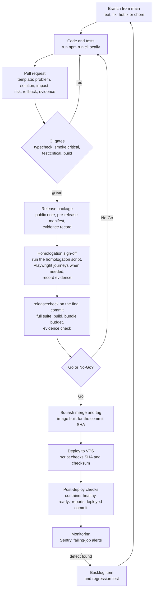

# GBP Manager: Release Validation

**TL;DR:** Each release goes from branch to PR, through CI gates, a release package (public note, pre-release manifest, evidence record) and a homologation sign-off, then a written go/no-go decision, deploy and monitoring.
Two scripts enforce this: `release:check` runs every local gate, and `release:evidence:check` refuses an incomplete evidence record.
The repo holds 63 homologation sign-off scripts, 46 pre-release manifests and 40 release evidence records.

Related documents: [QA strategy](qa-strategy.md) · [Test cases](test-cases.md) · [Bug case study](bug-case-study.md) · [Architecture](architecture.md) · [Overview](overview.md)

---

## Release flow

In practice I write the release documents in the same branch as the change.

| Step | What I check | Output |
|---|---|---|
| PR template | Problem, solution, impact; type of change; branch name and Conventional Commits; `npm run ci` run locally; docs updated; no contract break without notice; rollback plan for infra or data changes; how to validate manually; evidence (screenshots, logs); main risk and mitigation | PR description |
| CI gates | Type check, critical-flow guard, critical tests, build | Green or red run |
| Release package | Public note in plain language, pre-release manifest, evidence record | Three Markdown files per version |
| Homologation | Scenarios and acceptance criteria from the homologation script | Results and accepted pending items in the evidence record |
| Go/No-Go | Checklist below | Decision, owner, date and rollback criterion |
| Deploy | Expected SHA, image checksum, health check | Running container on the VPS |
| Post-deploy | Container health, `/api/readyz` commit and database | Post-deploy section of the evidence record |
| Monitoring | Sentry, failing jobs, dead letters | New backlog items and regression tests |

## Go-no-go checklist

Translated and shortened from my internal checklist. Sensitive details are removed.

### Delivery states

| State | Meaning |
|---|---|
| MVP | Usable internally or by a controlled client, small scope, known rollback |
| MMP | Minimum sellable flow: final texts, error handling, correct permissions, basic operational metric |
| Homologated | Tested in a real or equal sandbox environment, with recorded evidence, rollback plan and an owner |
| Commercially released | Ready for paying clients without mandatory manual follow-up |

### Minimum evidence for each delivery

- Owner of the validation.
- Closed scope and acceptance criteria.
- Main risks and expected fallback.
- Commands or scenarios that were run.
- Homologation result.
- Objective rollback criterion.

### General release gate (before any version leaves my machine)

- [ ] `package.json` and `package-lock.json` have the same version.
- [ ] The public release note for the version exists, in plain language.
- [ ] The public note points to an existing homologation script.
- [ ] The pre-release manifest exists and matches the public note.
- [ ] The evidence record exists, with commands, go/no-go decision and post-deploy section.
- [ ] `release:notes -- --check`, `release:prerelease -- --check` and `release:evidence:check` pass.
- [ ] `smoke:critical` confirms the sensitive flows are still covered.
- [ ] `test:critical` runs the highest-risk tests.
- [ ] `release:check` passes on the final commit, before GitHub and the VPS.

### Recurring operational evidence (bigger releases or operational risk)

- [ ] Generate the evidence record after the public note and the pre-release manifest.
- [ ] Fill in commands, environment, attachments, go/no-go decision and rollback criterion.
- [ ] If the release touches Google, Drive, media or Auto-Gallery: run the Auto-Gallery smoke in dry-run mode with real credentials and attach the JSON and Markdown report.
- [ ] If the real smoke cannot run before deploy: write down why, and keep the flow "released locally" until it runs.

### Gates by area

| Area | Go when | No-Go when | Rollback |
|---|---|---|---|
| Billing and checkout | Subscription creates the customer and charge with no duplicate. First payment releases access automatically. Webhooks and reconciliation are idempotent. A second copy of the invoice, or a status update, works. Charge description follows the standard text. | Charge without a linked customer. Access without confirmed payment (except configured courtesy plans). Technical error shown to the client without a friendly message. Client needs a manual fix to log in. | Turn off the feature flag. Go back to the previous payment method. Pause new public signups if there is financial risk. |
| Google onboarding | OAuth finishes without a stuck popup. Detected locations appear for selection. Selection creates or links clients and profiles before billing. Google API errors become practical actions. | Client can pay without an active linked location. The connected Google account is lost after the callback. Onboarding state differs between signup and panel. | Turn off self-service onboarding by feature flag. Keep assisted reconnection by the superadmin. |
| Google automation and media | Jobs respect permission, billing and client scope. Failures go to the job record, dead letters and audit. Not enough media does not break automation. Manual and automatic publishing have a fallback. Auto-Gallery dry-run gives a plan per location before publishing (ready, billing blocked, frequency reached, invalid folder, images already used). | A job publishes to the wrong client or profile. Automation repeats media with no rule. A Drive or Google failure stops the whole cycle. | Pause automation globally or per client. Turn off the feature for the profile. Reprocess only after checking account, folder and permission. |
| AI and assistants | Prompt has clear scope, language and limits. Answer uses the context of the selected client. Sensitive actions are advice only or go to a human. Interaction is auditable. | AI promises a deadline, a business result or an action it did not do. AI mixes another client's context. A silent failure leaves the client with no answer. | Turn off the AI call and use the deterministic fallback. Roll back to the previous prompt version. |
| Data, tenant or permission changes | Tests cover allowed access and cross-client and cross-role attempts. Migration is idempotent or has a recovery path. Backup before any bulk change. Deploy has a validated SHA and a post-deploy health check. Dry-run on a local or shadow schema first. | Data access without client or role scope. Destructive migration without backup and revert script. The change needs a manual data edit in production to work. | Restore the backup if data was damaged. Revert the feature flag or the deploy. Record the incident and keep the evidence. |

### Backlog closing rule

An item is "done" only when the promised scope is delivered (or reduced in writing), validation matching the risk was run, leftover work moved to another item, and the history says why it was closed. It stays "in progress" when a key acceptance criterion or the minimum evidence is missing.

### One-time pre-production checklist

Before go-live I also signed off a pre-production checklist with 8 areas: infrastructure and domain, security and credentials, database and backups (including a tested restore), Google and AI integrations, observability and operations, quality and UX (including desktop and mobile), deploy and rollback, and a final go/no-go with an end-to-end test on a real account.

A security review was performed. Findings were fixed or tracked in the backlog with a priority.

## Evidence stored for each release

Each evidence record (`docs/evidencias/releases/vX.Y.Z.md`) has the same structure:

| Section | What it holds |
|---|---|
| Header | Status, generation time, branch, base commit, and whether the worktree was clean |
| Linked artifacts | Public note, pre-release manifest, homologation script, attachments folder |
| Mandatory commands | A checkbox and a written result for each gate command |
| Auto-Gallery operational smoke | Dry-run command, result and decision (or why it was not run) |
| Manual evidence | Environment, whether a database was used for end-to-end tests, attachments, accepted pending items |
| Go/No-Go | Decision, owner, date, rollback criterion |
| Post-deploy | Deployed commit, tag, container status, `/api/readyz` result |

Attachment folders can hold validation summaries, a sanitized Auto-Gallery smoke report (JSON and Markdown), and a short README when the main evidence is in the record and the tests.

## Counts

All counts come from `git ls-files` on the main branch.

| Item | Count | Versions |
|---|---|---|
| Homologation sign-off scripts (`docs/homologacao-v0.9.*.md`) | 63 | v0.9.19 to v0.9.81 |
| Pre-release manifests (`docs/pre-releases/`) | 46 | v0.9.19 to v0.9.64 |
| Release evidence records (`docs/evidencias/releases/vX.Y.Z.md`) | 40 | v0.9.25 to v0.9.64 |
| Evidence attachment files (in version folders) | 9 (5 validation summaries, 2 READMEs, 1 smoke report as JSON plus its Markdown version), plus 2 empty placeholders | v0.9.49 to v0.9.64 |
| Other evidence documents | 2 (prospecting module MVP, guided activation smoke) | – |
| Entries in the public release notes | 64 | v0.9.1 to v0.9.64 |
| Version tags | 62 (v0.9.58 and v0.9.59 have no tag) | v0.9.1 to v0.9.64 |

## Sample sign-off: v0.9.29, Google popup at signup

Rewritten in English from the homologation script and the evidence record of v0.9.29. Commit hashes and internal names are removed.

**Objective.** Check that signup keeps the profiles received from the Google popup, even when the automatic follow-up reload returns an empty list or is slow.

**Main flow**

1. Open `/signup`.
2. Click "Conectar com Google" (Connect with Google).
3. Authorize the Google account.
4. Check that the locations appear without a page reload.
5. Check that the detected locations are selected.
6. Continue to the terms and the payment step.

**Acceptance criteria**

- The "Google connected" message appears.
- The profiles from the popup appear at once.
- An empty reload does not erase profiles already on the screen.
- It works on desktop and on mobile.

**Automated validation:** `test:e2e`, `lint:client`, `lint:server`, and `release:check -- --allow-dirty` before publishing.

**Accepted pending item:** manual check with real Google OAuth on the published domain.

**Evidence record**

| Command | Result |
|---|---|
| `release:notes -- --check` | OK |
| `release:prerelease -- --check` | OK |
| `smoke:critical` | OK |
| `test:critical` | OK |
| `release:evidence:check` | OK |
| `release:check -- --allow-dirty` | OK |
| `dev:status` | OK: front end, livez and readyz respond locally |
| `test:e2e` (Playwright) | OK: 39 passed, 1 mobile-only flow skipped on the desktop project by design |
| `lint:client`, `lint:server` | OK |

- Auto-Gallery dry-run: pending, not run for this version.
- Environment: local. Database used for end-to-end tests: yes, for authenticated Playwright sessions. The Google popup was simulated by a controlled test.
- **Go/No-Go:** Go. Release v0.9.29 to GitHub and the VPS (2026-05-03).
- **Rollback criterion:** follow the deploy runbook, and pause the affected feature if there is operational risk.
- **Post-deploy:** tag v0.9.29 published. Container status healthy. `/api/readyz` reported the deployed commit and a connected database.

This automated part became test case [GBP-TC-09](test-cases.md#test-cases), and the pending real-OAuth check became [GBP-TC-23](test-cases.md#test-cases).

## Scripts

### `release:check` (local release gate)

It stops at the first failure. In order:

1. `package.json` and `package-lock.json` versions match.
2. The required npm scripts exist (type checks, tests, critical tests, build, bundle check, smoke scripts, evidence scripts).
3. The required operations documents exist: go/no-go checklist, deploy runbook, backup and restore, versioning rules, alerts, public release notes.
4. The public note for the current version exists.
5. The tenant isolation tests and their key scenarios still exist, and the checklist still asks for a dry-run before tenant changes.
6. The git worktree is clean (skipped with `--allow-dirty` while a change is still local).
7. It runs, in order: client type check, server type check, public note check, pre-release manifest check, evidence check, `smoke:critical`, `test:critical`, the full server suite (`npm test`), the production build, and the bundle budget (each JS chunk at most 500 KiB). The `--quick` flag skips the build and bundle steps.

### `release:evidence:check` (evidence completeness)

It reads the version from `package.json` and fails if:

- the evidence record or the attachments folder for that version is missing;
- the record lacks any required part: header for the version, link to the pre-release manifest, link to a homologation script, the gate commands (note check, pre-release check, `smoke:critical`, `test:critical`, `release:check`), the Auto-Gallery smoke in dry-run mode, a Go/No-Go section with a decision, a rollback criterion, or a post-deploy section that mentions `/api/readyz`.

Limit: it checks that the record is complete, not that the results are true. I fill in the results myself after I run each command.

## Known gaps and next steps

I keep these visible on purpose. They are what I would fix next.

| Gap | Effect | What I would do next |
|---|---|---|
| I stopped bumping the package version after 0.9.64 (May 2026). | 17 later homologation scripts (v0.9.65 to v0.9.81) have no tag, pre-release manifest or evidence record. `release:check` still passes, because it checks the package version, and that version already has its evidence. | Bump the version for each release, so the evidence check covers every release. |
| API end-to-end scenarios are skipped in CI. | CI has no database, so the 12 scenarios run only on my machine. | Add a Postgres service to the CI job. |
| Playwright journeys do not run in CI. | They run locally before risky releases. | Run them in CI with a seeded test database. |
| Some evidence records leave post-deploy fields "pending" (for example v0.9.64). | The post-deploy result is not on record for that version. | Make the evidence check fail when post-deploy fields are still pending after deploy. |

---

[← Back to portfolio](../../README.md)
